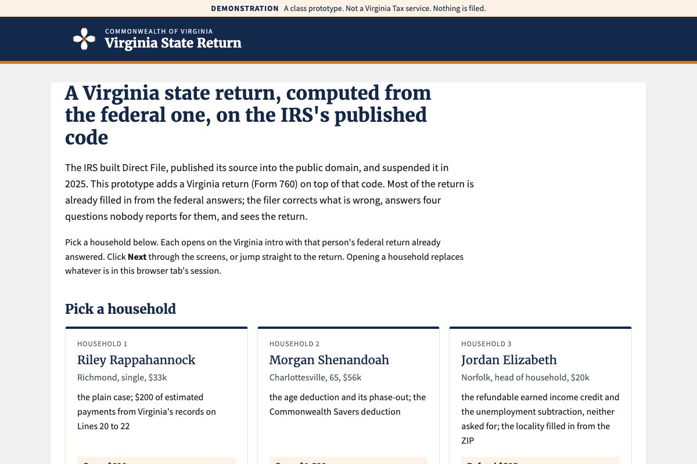
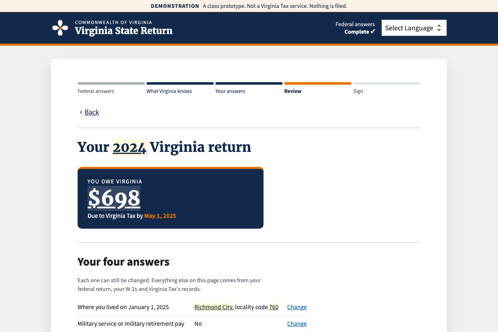
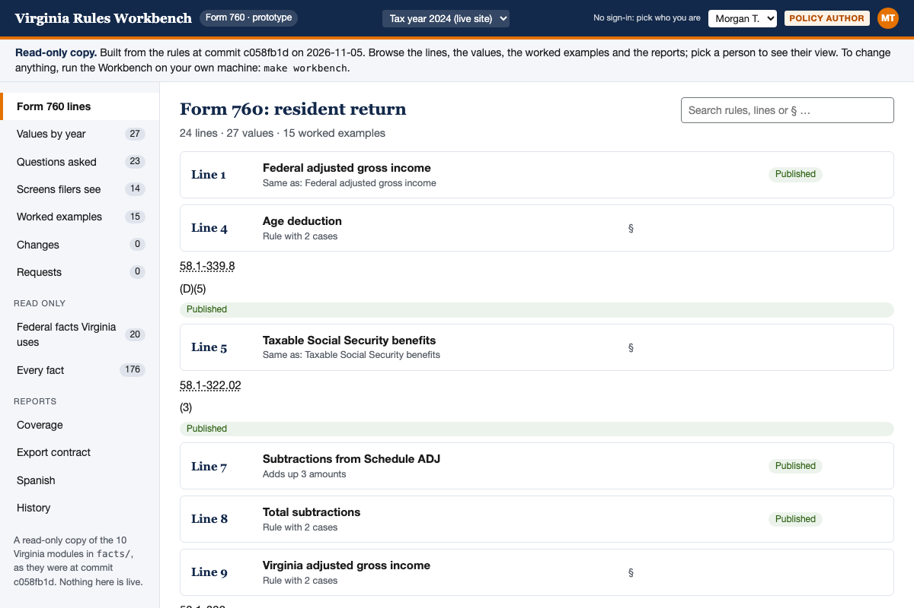

# A Virginia state return on IRS Direct File's public code

The IRS built Direct File, ran it in 25 states, published its source code into the public
domain, and suspended it in 2025. This repository asks one question of that code: could a state
with an income tax and no free filing tool take it and stand up its own filer? We answer with
Virginia: a Virginia return (Form 760) added to the IRS's own port of Direct File, every rule
traced to the Virginia Code, as a small change set a state team could take on its own.

A class project for Digital Public Infrastructure at Georgetown, fall 2026. A demonstration:
nothing is filed, nothing is endorsed by the IRS or Virginia Tax, and the households are invented.

## See it

**Hosted, nothing to install:** https://gchickering21.github.io/direct-file-virginia/app/direct-file/resources/start/
Open it and pick a household. (`make publish` rebuilds it; `docs/hosting.md` says how it is hosted, free.)

**On your own machine,** with Docker Desktop installed and running:

```bash
make demo        # checks the machine, builds and serves the site, then prints the link to the start page
```

Then open http://localhost:3008/app/direct-file/resources/start/ and pick a household. Riley
Rappahannock, a single filer in Richmond, owes $698. Everything else about running it, including
the native toolchain for anyone who will edit rules all day, is in `GETTING_STARTED.md`.

[](https://gchickering21.github.io/direct-file-virginia/app/direct-file/resources/start/)

| Riley's return, Form 760 line by line | The Rules Workbench, Form 760 with the statute beside each line |
|---|---|
|  |  |

## Who you are

| You are | Start here | Then |
|---|---|---|
| **a classmate, the professor, or curious** | the start page above: the four households, the return, the Workbench | `docs/architecture.md`, one page with two diagrams, and `handoff/BRIEF.md`, the one-page argument |
| **an engineer** who wants to read or change the rules | `GETTING_STARTED.md`, then `CONTRIBUTING.md` | `docs/changing-the-return.md` (to change X, go here), `docs/surfaces.md` (what the admin pages are), the ADRs in `virginia/direct-file/docs/adr/` |
| **policy staff**, or anyone who wants to change a figure without reading XML | the read-only Workbench on the hosted site, under "Look under the hood"; to change anything, `make workbench`, then http://localhost:3011 | `virginia/direct-file/workbench/README.md` |
| **a state team** taking the change set | `handoff/README.md` | `handoff/POLICY_MAP.md`, `handoff/FORM_760_FIELD_MAP.md`, the patch and its changelog |

The course material (the plan, the dated notes, the sources) is in `report/`.

## Three names

| Name | Means |
|---|---|
| **the Virginia site** | `virginia/direct-file/`: the IRS's port of Direct File onto Fact Graph and Form Builder, copied out of `form-builder-examples/` and changed here, with the Virginia return added: ten small rule modules (`facts/virginia*.xml`), fourteen screens, the scripts and the checks. A static site with the engine in the browser, no login, no database, served at http://localhost:3008/app/direct-file/. |
| **the 2025 archive** | `direct-file/`: the real federal application as the IRS published it. The "before". Optional, never modified, not needed for the Virginia work, and not in the repository: `make fetch-archive` clones it at the pin. |
| **the Workbench** | `virginia/direct-file/workbench/`: where policy staff change a figure, a rule, a question or the words on a screen in plain language, against worked examples, with approvals before anything is written into the XML. Port 3011, Node only. |

## What is in this folder

Ours:

| Path | What |
|---|---|
| `virginia/direct-file/` | the Virginia site: the IRS's `direct-file` application, copied out of `form-builder-examples/` at the pin and changed here. Two levels deep so the IRS's `../../` paths to its sibling libraries still resolve |
| `Makefile`, `stack/` | every command, and the scripts behind them: the machine check, the toolchain, the Docker overlays, the pinned browser tools |
| `GETTING_STARTED.md`, `CONTRIBUTING.md`, `docs/` | the guides: how to run it, how to change it; `docs/architecture.md` (how the pieces fit, with diagrams), `docs/hosting.md` (publishing the site for free), the surfaces, the change table, the macOS 13 detours, the 2025 archive |
| `handoff/` | the package for a state: the brief, the policy map, the Form 760 field map, the patch, its changelog and the proof it applies |
| `report/` | course material: the plan, the dated working notes, the sources |
| `IRS_PINS.md` | which commit of each IRS repository is used here, and how to move one |

The IRS's, at the commits in `IRS_PINS.md`, four of them vendored as squashed subtrees:

| Path | What |
|---|---|
| `form-builder-examples/` | the IRS's reference applications, untouched. `direct-file/` inside it is the application the Virginia site was copied from; the difference between the two is the change set |
| `fact-graph/` | Fact Graph 3.1, the rules engine |
| `form-builder/` | Flow XML and a fact dictionary to a static site |
| `taxpert/` | the developer workspace: the Scenario menu, Browse All, Author Mode, Fact Explorer |
| `direct-file/` | the 2025 archive, fetched by `make fetch-archive` when wanted (570 MB), ignored by git |

You will not need to open any of them to work on the Virginia return, and nothing in them is
ever edited (ADR-004 in `virginia/direct-file/docs/adr/`). They are here because the IRS's build
files expect them as siblings, and so that a state team starts from exactly the IRS's tree.

## Licence

The IRS code, all five repositories, is a work of the United States government, public domain
in the US and CC0 worldwide. Everything added here is CC0 as well (`LICENSE`). Nothing here is
branded as, or endorsed by, the IRS or Virginia Tax; every Virginia screen says on the screen
that it is a demonstration, and the demo households are invented.
