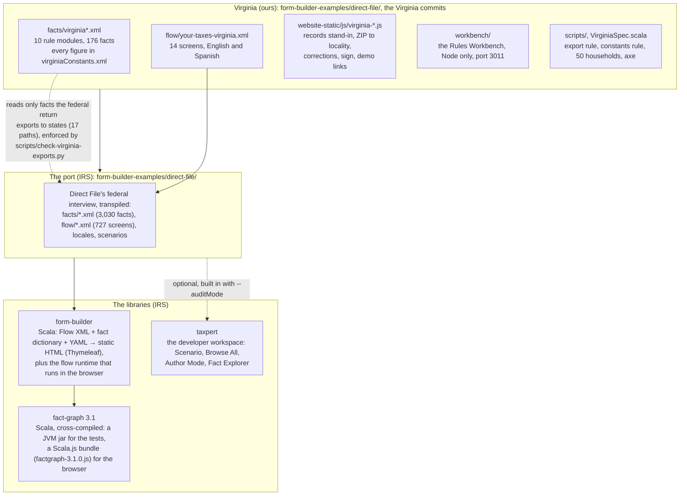
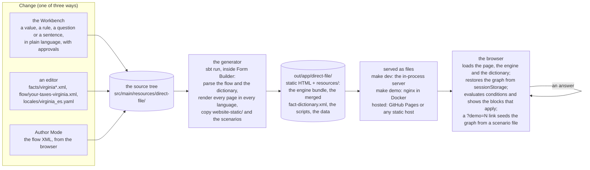

# How the pieces fit

One page for anyone who wants to understand the machine before, or instead of, reading the
code. Two diagrams: the layers, and the path from an edit to a screen. GitHub draws them;
in an editor that does not, the text under each says the same thing.

## 1. The layers

Four IRS libraries stacked, and the Virginia work as one thin layer on top, beside the federal
rules rather than inside them.

In words, bottom to top:

- **Fact Graph** is the rules engine. A fact dictionary is XML: each fact is a path like
  `/vaTax`, a type, and either a question (`<Writable>`) or a formula over other facts
  (`<Derived>`). The engine evaluates the graph lazily and tracks what is complete. It is
  written in Scala and compiled twice: to a jar the tests run, and to JavaScript the browser
  runs. The same rules give the same answers in both.
- **Form Builder** turns Flow XML (pages, questions, conditions), the fact dictionary and the
  YAML locale files into a static site, one HTML file per page per language. It also ships the
  flow runtime: the JavaScript that loads the engine in the browser, shows or hides blocks as
  conditions change, writes answers into the graph, and keeps the graph in session storage
  between pages.
- **Taxpert** is the developer workspace the IRS wraps around a built site: the Scenario menu
  that loads a saved household, Browse All, Author Mode and Fact Explorer. It is built in only
  when the generator is asked for it, so a production build has none of it.
- **The port** is the IRS's own reference application: Direct File's whole interview,
  transpiled from the 2025 service onto Form Builder. It is where the federal rules and screens
  live, untouched by the Virginia work.
- **Virginia** is ten rule modules, fourteen screens, a handful of browser scripts, the
  Workbench and the checks, all inside the port's folder as ordinary commits. The dotted line
  is the one design rule: a Virginia fact may read a federal fact only if the federal return
  already exports it to states, so the same module would be fed by the federal state API if
  that service came back.

## 2. From an edit to a screen

What happens when someone changes a figure, and what happens when a filer loads a page.
There is no server at runtime: the site is files, and the engine runs in the browser.

In words:

1. **A change is written into the source tree** by one of three hands: the Workbench (which
   writes the XML and the Spanish and runs the worked examples first), an editor, or Author
   Mode. Every tax-year figure goes into `virginiaConstants.xml`; every rule names its law.
2. **The generator rebuilds the site.** `make dev` keeps a watcher running and regenerates in
   about twenty seconds; `make demo` does the same inside Docker; `make site` builds once. The
   output is a folder of HTML and a `resources/` folder with the engine bundle, the merged
   dictionary, the scripts and the data files.
3. **Something serves the folder.** Locally the generator's own server or nginx; publicly any
   static host, since nothing runs on the server side (`docs/hosting.md`).
4. **The browser does the rest.** It loads the engine and the dictionary, restores the filer's
   graph from session storage, evaluates every condition, and renders the page. Each answer
   is written into the graph and the page updates. The Virginia scripts add the parts a state
   would get from its own systems: the records stand-in fills Lines 20 to 22, the ZIP lookup
   proposes the locality, and the demo link seeds a household from a scenario file.

## 3. What checks what

| Check | Runs where | Proves |
|---|---|---|
| `make check` | no JVM, a minute | the XML parses against the IRS schemas; Virginia reads only exported federal facts; every figure sits in the constants module with a tax year; every locality is listed in both switches; the Spanish keys match the English; the counts and fact paths quoted in the docs are true; the demo scenario files match their manifest; the Workbench's worked examples pass |
| `make test` | the JVM, the port's ScalaTest suite | the four demos' lines pinned exactly; 50 households through the full dictionary; the invariants of any Form 760 this module can produce; the federal suites unchanged |
| `make cases` | the browser, with the site running | the same 50 households, loaded into the real pages, every line compared with an independent model of the rules written from the Code rather than from the XML |
| `make a11y` | the browser | axe over every Virginia screen in both languages, the start page, the error states |

## Where to read more

- The IRS's own architecture page for the stack, with the build pipeline and the browser
  runtime in detail: `taxpert/docs/architecture.md`. Its ADR on what each of the three
  libraries owns: `taxpert/docs/adr/taxpert-form-builder-fact-graph.md`.
- The decisions behind the Virginia layer: `form-builder-examples/direct-file/docs/adr/`.
- What each Virginia file is: the "What is here" section of
  `form-builder-examples/direct-file/docs/virginia/README.md`.
- To change X, go here: `docs/changing-the-return.md`. The admin pages: `docs/surfaces.md`.
